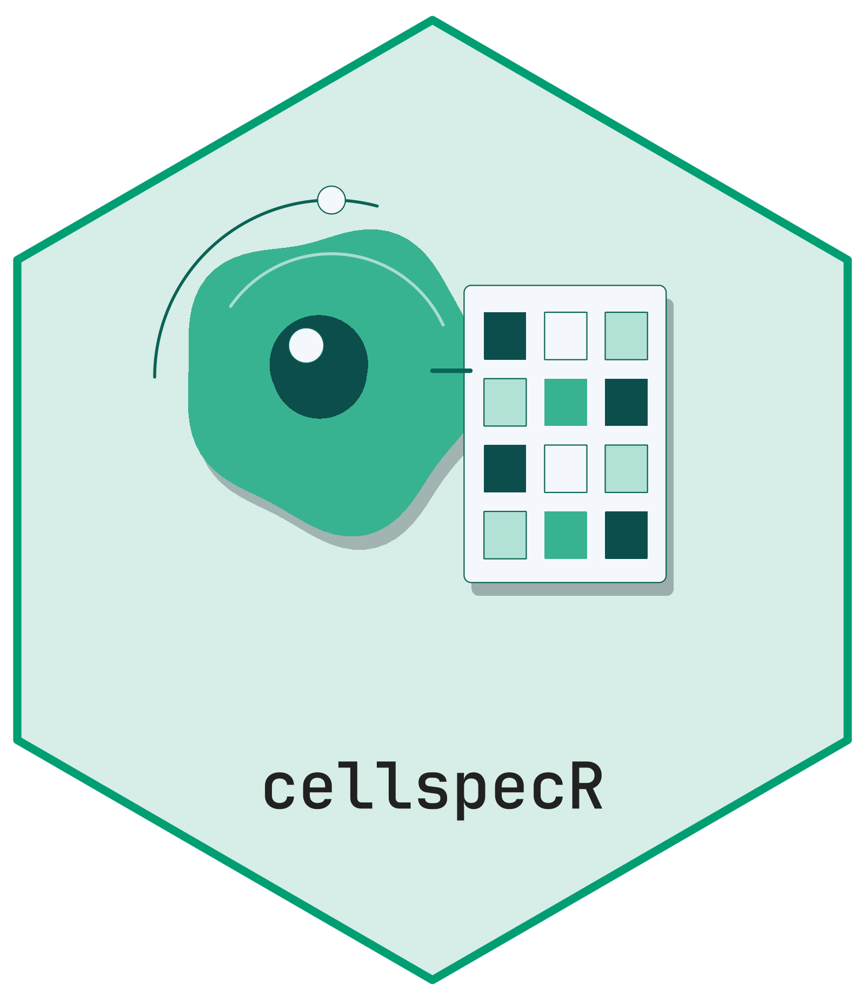

- [cellspecR](#cellspecr-)
  - [Install](#install)
  - [Quick start](#quick-start)
  - [What the package provides](#what-the-package-provides)
  - [Data and reproducibility](#data-and-reproducibility)
  - [Contributing and license](#contributing-and-license)

# cellspecR <picture class="cttir-readme-logo"><source class="cttir-logo-dark-source" media="(prefers-color-scheme: dark)" srcset="man/figures/logo-with-name-dark.png" /></picture>

<!-- badges: start -->

[](https://lifecycle.r-lib.org/articles/stages.html#stable)
[](https://opensource.org/licenses/MIT)
<!-- badges: end -->

`cellspecR` defines the `cellspec` 1.0 table contract for segmented
cells from multiplexed tissue images. It reads tool exports, validates
structure and semantics, and writes an integrity checked directory for
downstream analysis.

> **Status: 1.0.0 release candidate.** The specification, object model,
> validation, canonical I/O, signal policy, combination helpers,
> specialized readers, interoperability, plots and the Shiny app are
> included in this release. Local and shared CI hardening checks are
> complete; external fixture comparisons and CRAN submission remain
> maintainer actions.

## Install

``` r
# install.packages("pak")
pak::pak("CTTIR/cellspecR")
```

## Quick start

``` r
x <- cs_example()
print(x)
#> <cellspec> spec 1.0.0
#>   cells     80 in 2 images (2 samples)
#>   features  19: 16 intensity, 2 shape, 1 other
#>   markers   4: DAPI, CD3e, Pan-Cytokeratin, FOXP3
#>   pixel     0.5 um/px
#>   adjacency none
#>   source    simulate 1.0.0 (cellspecR simulator 1.0.0)
cs_validate(x)
#> <cellspec validation> 45 checks: 0 fail, 0 warn, 0 skip, 45 pass
#> pass 45 other checks

policy <- cs_signal_policy(
  marker = c("CD3e", "FOXP3"),
  compartment = c("cell", "nucleus"),
  statistic = "mean"
)
signal <- cs_signal_matrix(x, policy)
dim(signal$signal)
#> [1] 80  2

destination <- file.path(tempdir(), "cellspec-example")
cs_write(x, destination, overwrite = TRUE)
cs_verify(destination)
#>                        file
#> cells.parquet cells.parquet
#> cellspec.json cellspec.json
#> 1                      DONE
#>                                                                       expected
#> cells.parquet 67ca57b984c08b81087d62183e3602dac68637447b40f3a7bf0697bc98557994
#> cellspec.json 990e5555e66725fefc2bd165df7022ed3aa217ed2a47df2b57e654a33986cdb9
#> 1             a6fe4004b01506e040b1f276afdac06d70416451a31a9fbf598536be3509f9de
#>                                                                       observed
#> cells.parquet 67ca57b984c08b81087d62183e3602dac68637447b40f3a7bf0697bc98557994
#> cellspec.json 990e5555e66725fefc2bd165df7022ed3aa217ed2a47df2b57e654a33986cdb9
#> 1             a6fe4004b01506e040b1f276afdac06d70416451a31a9fbf598536be3509f9de
#>                 ok
#> cells.parquet TRUE
#> cellspec.json TRUE
#> 1             TRUE
y <- cs_read_cellspec(destination)
identical(cs_cells(x), cs_cells(y))
#> [1] TRUE
```

## What the package provides

- `cs_read()` and `cs_detect_format()` for tool exports, plus
  `cs_column_map()` for explicit generic tables.
- `cs_new()`, accessors, subsetting and compact print and summary
  methods.
- `cs_validate()` and `cs_feature_support()` for structural and signal
  quality checks.
- Parquet or exact text storage with a JSON sidecar, SHA-256 manifest
  and atomic staging through `cs_write()` and `cs_read_cellspec()`.
- Explicit signal policies, marker maps, object binding and tiled
  ownership.
- Optional conversion to `SpatialExperiment` and AnnData,
  quality-control plots and a local Shiny review app.

The package does not segment images, normalize signals, gate cells or
perform spatial statistics. It keeps the table contract and provenance
at the boundary between those tools.

## Data and reproducibility

The bundled export in `inst/extdata/` is synthetic and contains no
patient data. Reader fixtures record their generator, header grammar and
SHA-256 in `tests/testthat/fixtures/README.md`. Examples do not access
the network.

## Contributing and license

Contributions follow the [CTTIR contributing
guide](https://github.com/CTTIR/.github/blob/main/CONTRIBUTING.md). The
package is released under the MIT license.

## Use of LLM tools

Where applicable, LLM tools were used for narrowly defined, non-authorial tasks:
copyediting, prose refinement, Markdown/LaTeX formatting, boilerplate scaffolding
(such as CI configurations and build scripts), and code refactoring. Tools included
[Chat AI](https://kisski.gwdg.de/leistungen/2-02-llm-service/), the KISSKI
(GWDG) service, and self-hosted **Mistral Small (24B, Apache-2.0)** served through
a local **vLLM architecture** on an Ubuntu Linux workstation with Intel
processors and NVIDIA GPUs. The self-hosted model ran locally, with no data sent
to third parties.

All scientific claims, methodological choices, analyses, interpretations and
conclusions remain the authors' own. Where applicable, LLM-generated material
must be reviewed and revised before inclusion, and references must be verified
against their DOI, arXiv ID or ISBN.

Local software setup: vLLM with Python/PyTorch, plus R and RStudio.

## Branding

Editable R sources and regeneration instructions are in
[tools/branding](https://github.com/CTTIR/cellspecR/tree/main/tools/branding).
