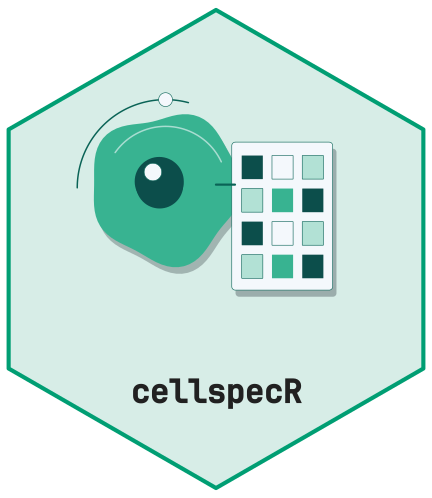

# Adapter reference



[`cs_formats()`](https://cttir.github.io/cellspecR/reference/cs_formats.md)
is the machine-readable index of supported reader grammars. Each adapter
preserves the source column name in `dictionary$source_name` and records
its adapter and version in provenance.

``` r

knitr::kable(cs_formats())
```

| format | adapter_version | description | tested_with | status |
|:---|:---|:---|:---|:---|
| table | 1.0.0 | Generic delimited table with an explicit column map. | CSV, TSV and gzip-compressed delimited files | stable |
| qupath | 1.0.1 | QuPath colon-delimited measurement export | QuPath 0.6.0 and 0.7.0 | experimental |
| qupath_tiled | 1.0.1 | Tiled QuPath tables with centroid ownership | QuPath 0.7.0 | experimental |
| mcquant | 1.0.0 | MCMICRO MCQuant measurement export | MCMICRO/MCQuant | experimental |
| segmantr | 1.0.1 | segmantR feature table | segmantR 0.2.0 | experimental |
| inform | 1.0.0 | inForm cell segmentation data | inForm/phenoptr | experimental |

The QuPath adapter accepts both channel-first headers such as
`DAPI: Mean` and compartment-first headers such as
`Nucleus: CD3e: Mean`. The tiled adapter adds an ownership pass over
outer tile boxes; halo rows are counted and dropped. MCQuant and
segmantR readers treat `centroid_col` as x and `centroid_row` as y, and
require pixel calibration.

When no grammar is decisive, `cs_read(format = "auto")` returns a
classified ambiguity error and lists the candidates. This prevents a
plausible but wrong column match from reaching downstream analysis.
