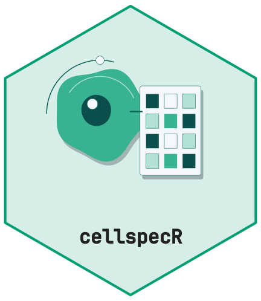

# Interoperability with SpatialExperiment and AnnData



The SpatialExperiment conversion keeps the selected signal as the main
assay, all raw measurements as an alternative experiment, and stores the
images, channels, provenance and policy in metadata.

``` r

if (requireNamespace("SpatialExperiment", quietly = TRUE)) {
  spe <- cs_as_spe(x, policy)
  dim(spe)
  y <- cs_from_spe(spe)
  identical(cs_measurements(x), cs_measurements(y))
} else {
  message("Install SpatialExperiment to run this section.")
}
#> Warning: replacing previous import 'S4Arrays::makeNindexFromArrayViewport' by
#> 'DelayedArray::makeNindexFromArrayViewport' when loading 'SummarizedExperiment'
#> [1] TRUE
```

AnnData conversion is optional and requires `anndataR`. Its default
in-memory implementation works in R without a Python runtime.

``` r

if (requireNamespace("anndataR", quietly = TRUE)) {
  result <- cs_as_anndata(x, policy)
  dim(result)
} else {
  message("Install anndataR to run this section.")
}
#> [1] 80  4
```
