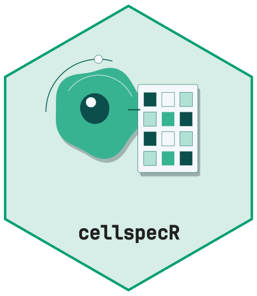

# Performance measurements

This article records the development-machine performance measurements
for cellspecR. It is a pkgdown article and is excluded from the CRAN
vignette build because the benchmark data size is intentionally
configurable.

Run `Rscript data-raw/benchmarks/performance.R` to generate the local
measurements.
