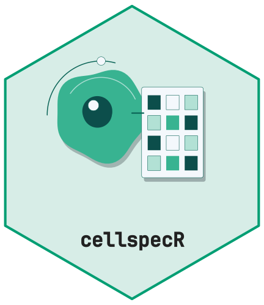

<!-- cttir-vignette-logo: start -->
<style>
.cttir-vignette-logo { float: right; width: 120px; max-width: 30%; margin: 0 0 1rem 1.5rem; }
.cttir-vignette-logo img { width: 100%; height: auto; border: 0; background: transparent; box-shadow: none; }
.cttir-vignette-logo .cttir-vignette-logo-light { display: block; }
.cttir-vignette-logo .cttir-vignette-logo-dark { display: none; }
@media (prefers-color-scheme: dark) {
  .cttir-vignette-logo .cttir-vignette-logo-light { display: none; }
  .cttir-vignette-logo .cttir-vignette-logo-dark { display: block; }
}
[data-bs-theme="light"] .cttir-vignette-logo .cttir-vignette-logo-light { display: block; }
[data-bs-theme="light"] .cttir-vignette-logo .cttir-vignette-logo-dark { display: none; }
[data-bs-theme="dark"] .cttir-vignette-logo .cttir-vignette-logo-light { display: none; }
[data-bs-theme="dark"] .cttir-vignette-logo .cttir-vignette-logo-dark { display: block; }
</style>
<div class="cttir-vignette-logo">
  
  
</div>
<!-- cttir-vignette-logo: end -->

This article records the development-machine performance measurements for
cellspecR. It is a pkgdown article and is excluded from the CRAN vignette
build because the benchmark data size is intentionally configurable.

```{r, echo=FALSE, results='asis'}
# The record lives in the repository, two levels above this article; the
# second candidate serves a render from the package root.
candidates <- file.path(c(file.path("..", ".."), "."), "data-raw", "benchmarks", "performance.md")
path <- candidates[file.exists(candidates)][1L]
if (is.na(path)) {
  cat("Run `Rscript data-raw/benchmarks/performance.R` to generate the local measurements.")
} else {
  lines <- readLines(path, warn = FALSE, encoding = "UTF-8")
  # The article has its own title; printed tables are shown as code.
  lines <- lines[!grepl("^# cellspecR performance measurements", lines)]
  table_start <- grepl("^# A tibble", lines)
  blank <- !nzchar(trimws(lines))
  in_table <- FALSE
  out <- character()
  for (i in seq_along(lines)) {
    if (table_start[[i]]) {
      out <- c(out, "```")
      in_table <- TRUE
    } else if (in_table && blank[[i]]) {
      out <- c(out, "```")
      in_table <- FALSE
    }
    out <- c(out, lines[[i]])
  }
  if (in_table) out <- c(out, "```")
  cat(paste(out, collapse = "\n"))
}
```
