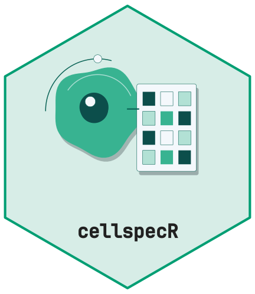

<!-- cttir-vignette-logo: start -->
<style>
.cttir-vignette-logo { float: right; width: 120px; max-width: 30%; margin: 0 0 1rem 1.5rem; }
.cttir-vignette-logo img { width: 100%; height: auto; border: 0; background: transparent; box-shadow: none; }
.cttir-vignette-logo .cttir-vignette-logo-light { display: block; }
.cttir-vignette-logo .cttir-vignette-logo-dark { display: none; }
@media (prefers-color-scheme: dark) {
  .cttir-vignette-logo .cttir-vignette-logo-light { display: none; }
  .cttir-vignette-logo .cttir-vignette-logo-dark { display: block; }
}
[data-bs-theme="light"] .cttir-vignette-logo .cttir-vignette-logo-light { display: block; }
[data-bs-theme="light"] .cttir-vignette-logo .cttir-vignette-logo-dark { display: none; }
[data-bs-theme="dark"] .cttir-vignette-logo .cttir-vignette-logo-light { display: none; }
[data-bs-theme="dark"] .cttir-vignette-logo .cttir-vignette-logo-dark { display: block; }
</style>
<div class="cttir-vignette-logo">
  
  
</div>
<!-- cttir-vignette-logo: end -->

```{r, include = FALSE}
knitr::opts_chunk$set(collapse = TRUE, comment = "#>")
library(cellspecR)
```

`cellspecR` puts an explicit contract between segmentation and downstream
analysis. The first object to inspect is the deterministic bundled example.

```{r}
x <- cs_example()
x
summary(x)
cs_validate(x)
```

The dictionary describes every measurement, including its compartment and
statistic. Select features through dictionary fields rather than parsing a
feature name.

```{r}
cs_features(x, kind = "intensity", marker = "CD3e", statistic = "mean")
cs_feature_support(x)
```

Signal selection is explicit and recorded as a policy.

```{r}
policy <- cs_signal_policy(
  marker = c("CD3e", "FOXP3"),
  compartment = c("cell", "nucleus"),
  statistic = "mean"
)
selected <- cs_signal_matrix(x, policy)
head(selected$signal)
```

Quality-control plots show where the cells lie, which features carry signal
and how the cell areas and one marker are distributed. They need the suggested
ggplot2 package, and patchwork for the overview. The map follows the image
frame, with the origin at the top left.

```{r qc-overview, eval = requireNamespace("ggplot2", quietly = TRUE) && requireNamespace("patchwork", quietly = TRUE), fig.width = 8, fig.height = 7, dpi = 96, out.width = "100%", fig.alt = "Four panels for the example object: a map of cell centroids coloured by image, a heatmap of the fraction of zero values per feature and image, a histogram of cell areas per image, and violins of the DAPI signal per compartment and statistic."}
plot(x)
```

A single view is selected with `type`. With a policy, the marker plot shows the
signal that the policy selects.

```{r qc-marker, eval = requireNamespace("ggplot2", quietly = TRUE), fig.width = 8, fig.height = 3.6, dpi = 96, out.width = "100%", fig.alt = "Violins of the selected FOXP3 signal, one panel per image."}
plot(x, type = "marker", marker = "FOXP3", policy = policy)
```

Finally, write an integrity checked directory and verify it before handing the
object to another analysis package.

```{r}
destination <- file.path(tempdir(), "cellspec-getting-started")
cs_write(x, destination, overwrite = TRUE)
cs_verify(destination)
y <- cs_read_cellspec(destination)
identical(cs_cells(x), cs_cells(y))
```
