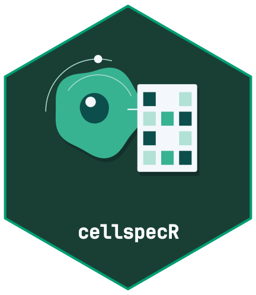

<!-- cttir-vignette-logo: start -->
<style>
.cttir-vignette-logo { float: right; width: 120px; max-width: 30%; margin: 0 0 1rem 1.5rem; }
.cttir-vignette-logo img { width: 100%; height: auto; border: 0; background: transparent; box-shadow: none; }
.cttir-vignette-logo .cttir-vignette-logo-light { display: block; }
.cttir-vignette-logo .cttir-vignette-logo-dark { display: none; }
@media (prefers-color-scheme: dark) {
  .cttir-vignette-logo .cttir-vignette-logo-light { display: none; }
  .cttir-vignette-logo .cttir-vignette-logo-dark { display: block; }
}
[data-bs-theme="light"] .cttir-vignette-logo .cttir-vignette-logo-light { display: block; }
[data-bs-theme="light"] .cttir-vignette-logo .cttir-vignette-logo-dark { display: none; }
[data-bs-theme="dark"] .cttir-vignette-logo .cttir-vignette-logo-light { display: none; }
[data-bs-theme="dark"] .cttir-vignette-logo .cttir-vignette-logo-dark { display: block; }
</style>
<div class="cttir-vignette-logo">
  
  
</div>
<!-- cttir-vignette-logo: end -->

```{r, include = FALSE}
knitr::opts_chunk$set(collapse = TRUE, comment = "#>")
library(cellspecR)
x <- cs_example()
policy <- cs_signal_policy(cs_markers(x))
```

The SpatialExperiment conversion keeps the selected signal as the main assay,
all raw measurements as an alternative experiment, and stores the images,
channels, provenance and policy in metadata.

```{r}
if (requireNamespace("SpatialExperiment", quietly = TRUE)) {
  spe <- cs_as_spe(x, policy)
  dim(spe)
  y <- cs_from_spe(spe)
  identical(cs_measurements(x), cs_measurements(y))
} else {
  message("Install SpatialExperiment to run this section.")
}
```

AnnData conversion is optional and requires an `anndataR` installation with a
working Python AnnData runtime.

```{r}
if (requireNamespace("anndataR", quietly = TRUE)) {
  result <- tryCatch(cs_as_anndata(x, policy), error = function(e) e)
  if (inherits(result, "error")) message(conditionMessage(result)) else result
} else {
  message("Install anndataR to run this section.")
}
```
